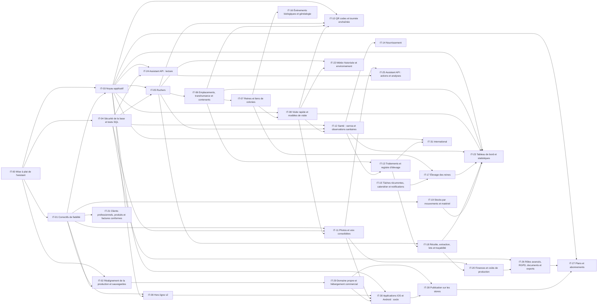

<!-- Généré depuis la structure du backlog le 5 nov. 2026. Après génération, ce fichier est maintenu à la main (voir README). Révisée le 6 nov. 2026 : application web et stores (IT-29, IT-30, IT-28 avancée, IT-31), voir `12_DISTRIBUTION_ET_MONETISATION.md`. -->

# 08 — Roadmap globale

Découpage en 10 phases et 32 itérations (IT-00 à IT-31 ; les numéros sont des identifiants, pas un ordre : l'ordre est celui des phases). Chaque itération est livrable seule, passe par la recette puis la production (doc 10).

Tailles : XS (quelques heures) · S (1 à 3 sessions de travail) · M (une à deux semaines de travail) · L (plusieurs semaines) · XL (à redécouper). Aucune durée calendaire n'est donnée : l'effort réel dépend du temps disponible et des validations sur téléphone.

## 1. Vue d'ensemble

| Phase | Itération | Nom | Taille | Fonctionnalités | Dépend de |
|---|---|---|---|---|---|
| Phase 0 | [IT-00](ITERATIONS/ITERATION_00.md) | Mise à plat de l'existant | S | 3 | — |
| Phase 0 | [IT-01](ITERATIONS/ITERATION_01.md) | Correctifs de fiabilité | S | 8 | IT-00 |
| Phase 0 | [IT-02](ITERATIONS/ITERATION_02.md) | Réalignement de la production et sauvegardes | S | 2 | IT-00, IT-01 |
| Phase 0 | [IT-29](ITERATIONS/ITERATION_29.md) | Domaine propre et hébergement commercial | S | 1 | IT-02 |
| Phase 0 | [IT-03](ITERATIONS/ITERATION_03.md) | Noyau applicatif | L | 9 | IT-00, IT-01 |
| Phase 0 | [IT-04](ITERATIONS/ITERATION_04.md) | Sécurité de la base et tests SQL | M | 7 | IT-00 |
| Phase 1 | [IT-05](ITERATIONS/ITERATION_05.md) | Ruchers | M | 3 | IT-03, IT-04 |
| Phase 1 | [IT-06](ITERATIONS/ITERATION_06.md) | Emplacements, transhumance et contenants | L | 4 | IT-05 |
| Phase 1 | [IT-07](ITERATIONS/ITERATION_07.md) | Reines et liens de colonies | M | 3 | IT-06 |
| Phase 2 | [IT-08](ITERATIONS/ITERATION_08.md) | Visite rapide et modèles de visite | M | 5 | IT-03, IT-07 |
| Phase 2 | [IT-09](ITERATIONS/ITERATION_09.md) | Hors ligne v2 | L | 3 | IT-01, IT-03 |
| Phase 2 | [IT-10](ITERATIONS/ITERATION_10.md) | QR codes et tournée enchaînée | M | 3 | IT-03, IT-05, IT-06, IT-08 |
| Phase 2 | [IT-11](ITERATIONS/ITERATION_11.md) | Photos et voix consolidées | S | 3 | IT-01, IT-04, IT-08 |
| Phase 2 | [IT-30](ITERATIONS/ITERATION_30.md) | Applications iOS et Android : socle | L | 2 | IT-03, IT-09, IT-11, IT-29 |
| Phase 2 | [IT-28](ITERATIONS/ITERATION_28.md) | Publication sur les stores | M | 2 | IT-29, IT-30 |
| Phase 3 | [IT-12](ITERATIONS/ITERATION_12.md) | Santé : varroa et observations sanitaires | M | 4 | IT-04, IT-05, IT-08 |
| Phase 3 | [IT-13](ITERATIONS/ITERATION_13.md) | Traitements et registre d'élevage | L | 6 | IT-06, IT-12 |
| Phase 3 | [IT-14](ITERATIONS/ITERATION_14.md) | Nourrissement | M | 2 | IT-12 |
| Phase 3 | [IT-15](ITERATIONS/ITERATION_15.md) | Tâches récurrentes, calendrier et notifications | L | 5 | — |
| Phase 4 | [IT-16](ITERATIONS/ITERATION_16.md) | Événements biologiques et généalogie | M | 3 | IT-07 |
| Phase 4 | [IT-17](ITERATIONS/ITERATION_17.md) | Élevage des reines | L | 3 | IT-07, IT-15 |
| Phase 5 | [IT-18](ITERATIONS/ITERATION_18.md) | Récolte, extraction, lots et traçabilité | L | 6 | IT-05, IT-13 |
| Phase 6 | [IT-19](ITERATIONS/ITERATION_19.md) | Stocks par mouvements et matériel | M | 3 | IT-01 |
| Phase 6 | [IT-20](ITERATIONS/ITERATION_20.md) | Finances et coûts de production | M | 4 | IT-11, IT-18 |
| Phase 7 | [IT-21](ITERATIONS/ITERATION_21.md) | Clients professionnels, produits et factures conformes | L | 8 | IT-01 |
| Phase 8 | [IT-22](ITERATIONS/ITERATION_22.md) | Météo historisée et environnement | M | 3 | IT-05, IT-08 |
| Phase 8 | [IT-23](ITERATIONS/ITERATION_23.md) | Tableau de bord et statistiques | M | 9 | IT-03, IT-06, IT-08, IT-12, IT-17, IT-18, IT-19 |
| Phase 8 | [IT-24](ITERATIONS/ITERATION_24.md) | Assistant API : lecture | L | 2 | IT-03, IT-04 |
| Phase 8 | [IT-25](ITERATIONS/ITERATION_25.md) | Assistant API : actions et analyses | M | 4 | IT-11, IT-24 |
| Phase 9 | [IT-26](ITERATIONS/ITERATION_26.md) | Rôles avancés, RGPD, documents et exports | M | 7 | IT-04, IT-20 |
| Phase 9 | [IT-27](ITERATIONS/ITERATION_27.md) | Plans et abonnements | L | 4 | IT-03, IT-26, IT-28 |
| Phase 9 | [IT-31](ITERATIONS/ITERATION_31.md) | International | M | 2 | IT-03, IT-13 |

## 2. Graphe des dépendances entre itérations

## 3. Phases

### Phase 0 — Sécuriser et maîtriser l'existant

- **IT-00 — Mise à plat de l'existant** (S) : Disposer d'une source lisible du cœur, d'un relevé fidèle des deux bases et d'une documentation de base exacte.
- **IT-01 — Correctifs de fiabilité** (S) : Supprimer les pertes de données et les fuites identifiées par l'audit avant la bascule en production.
- **IT-02 — Réalignement de la production et sauvegardes** (S) : Faire correspondre base de production et version publiée, corriger la documentation d'état, et mettre en place une sauvegarde restaurable.
- **IT-03 — Noyau applicatif** (L) : Remplacer les surcharges en chaîne par un noyau d'écrans enregistrés et une couche de données ciblée, puis supprimer le code mort.
- **IT-29 — Domaine propre et hébergement commercial** (S) : Quitter GitHub Pages (usage commercial exclu) pendant que la base d'utilisateurs est petite, sans perdre aucune saisie locale.
- **IT-04 — Sécurité de la base et tests SQL** (M) : Garantir par des tests automatiques que chaque exploitation ne voit et ne modifie que ses données, et maîtriser les accès.

### Phase 1 — Socle métier : ruchers, colonies, reines

- **IT-05 — Ruchers** (M) : Faire du rucher une entité avec position, accès et informations, sans casser l'existant.
- **IT-06 — Emplacements, transhumance et contenants** (L) : Savoir où était chaque colonie à toute date, déplacer des lots de colonies, et suivre les ruches physiques.
- **IT-07 — Reines et liens de colonies** (M) : Historiser les reines et structurer la filiation entre colonies.

### Phase 2 — Expérience terrain

- **IT-08 — Visite rapide et modèles de visite** (M) : Atteindre une visite courante en moins de deux minutes, adaptée aux pratiques de chacun.
- **IT-09 — Hors ligne v2** (L) : Permettre toutes les saisies terrain sans réseau et ne jamais perdre une saisie.
- **IT-10 — QR codes et tournée enchaînée** (M) : Ouvrir une colonie en scannant sa ruche et enchaîner les visites d'un rucher.
- **IT-11 — Photos et voix consolidées** (S) : Rendre photos et dictée fiables sur vrais téléphones et maîtriser le quota.
- **IT-30 — Applications iOS et Android : socle** (L) : Construire, depuis le même code, des applications qui s'ouvrent hors ligne et utilisent les fonctions natives ; builds de test.
- **IT-28 — Publication sur les stores** (M) : Publier gratuitement sur l'App Store et Google Play, avec suppression de compte et confidentialité conformes.

### Phase 3 — Santé et conduite du rucher

- **IT-12 — Santé : varroa et observations sanitaires** (M) : Suivre l'infestation et les signes sanitaires par colonie et par rucher, avec des seuils dont la source est affichée.
- **IT-13 — Traitements et registre d'élevage** (L) : Enregistrer un traitement une fois pour toutes les colonies concernées et produire un registre fiable.
- **IT-14 — Nourrissement** (M) : Enregistrer un nourrissement groupé avec quantités, coût et objectif.
- **IT-15 — Tâches récurrentes, calendrier et notifications** (L) : Planifier, répartir et être réellement rappelé, même application fermée.

### Phase 4 — Multiplication et élevage

- **IT-16 — Événements biologiques et généalogie** (M) : Diviser, réunir, enregistrer un essaim ou un remérage en une opération sûre, et voir la généalogie.
- **IT-17 — Élevage des reines** (L) : Suivre les séries d'élevage de reines et la réussite par lignée.

### Phase 5 — Production et traçabilité

- **IT-18 — Récolte, extraction, lots et traçabilité** (L) : Tracer chaque pot jusqu'aux colonies et à la récolte, et calculer les rendements.

### Phase 6 — Gestion de l'exploitation

- **IT-19 — Stocks par mouvements et matériel** (M) : Avoir un stock juste et savoir où est le matériel.
- **IT-20 — Finances et coûts de production** (M) : Connaître le coût par kg, par rucher et par colonie, et fournir des exports au comptable.

### Phase 7 — Commercialisation

- **IT-21 — Clients professionnels, produits et factures conformes** (L) : Vendre à des professionnels avec des factures fiables et suivre les paiements.

### Phase 8 — Pilotage et intelligence

- **IT-22 — Météo historisée et environnement** (M) : Relier observations et conditions, et préparer les miellées.
- **IT-23 — Tableau de bord et statistiques** (M) : Donner à chaque profil les bons indicateurs et comparer les saisons.
- **IT-24 — Assistant API : lecture** (L) : Répondre en langage naturel aux questions sur ses propres données, en séparant faits, hypothèses, recommandations et manques.
- **IT-25 — Assistant API : actions et analyses** (M) : Transformer une note vocale en visite, préparer une tournée, détecter données manquantes et anomalies.

### Phase 9 — Professionnalisation SaaS et monétisation

- **IT-26 — Rôles avancés, RGPD, documents et exports** (M) : Permettre des équipes (saisonniers), garantir les droits des personnes et ranger les documents.
- **IT-27 — Plans et abonnements** (L) : Proposer une offre gratuite et une offre payante, sur le web et par achat intégré dans les applications, sans dégrader l'expérience gratuite.
- **IT-31 — International** (M) : Préparer l'ouverture à d'autres pays (textes et cadre réglementaire).

## 4. Chemin critique

IT-00 → IT-01 → IT-02 (production unifiée) → IT-03 (noyau) → IT-04 (tests SQL) → IT-05 → IT-06 → IT-07 (modèle colonies) → IT-12 → IT-13 (santé et registre) → IT-16 → IT-18 (traçabilité). Tout retard sur IT-03 ou IT-07 décale l'ensemble des phases 3 à 5.

Chemin de la distribution : IT-02 → **IT-29** (domaine) → IT-03 → IT-09 et IT-11 → **IT-30** (applications) → **IT-28** (stores, gratuit) → … → IT-26 → **IT-27** (paiement web et achats intégrés). IT-29 est courte mais à ne pas différer : chaque nouvel utilisateur rend la bascule de domaine plus délicate (12 §2).

## 5. Parallélisation possible

- IT-08 (visite rapide) et IT-10 (QR) peuvent avancer pendant IT-09 si deux personnes travaillent.
- IT-19/IT-20 (gestion) ne dépendent pas de la phase 4 : elles peuvent passer avant l'élevage si le besoin est plus fort.
- IT-22 (météo) est indépendante après IT-08.
- IT-24/IT-25 (assistant) peuvent démarrer dès IT-14 si un prototype est souhaité, en lecture seule.
- IT-29 (domaine) peut se faire en parallèle d'IT-03 et IT-04 : elle ne touche que la publication.
- Les démarches longues d'IT-28 (comptes développeur, D-13, test fermé Google de 14 jours) peuvent commencer pendant IT-30.

## 6. Jalons de décision

| Jalon | Après | Question à trancher |
|---|---|---|
| J1 | IT-02, IT-29 | La production est-elle stable sur la v5 et sur le nouveau domaine ? Ouvrir les inscriptions ? Passer la production en Supabase Pro ? |
| J2 | IT-04 | Le noyau et les tests SQL suffisent-ils, ou faut-il réexaminer une étape de compilation ? |
| J3 | IT-07 | Le modèle colonies/contenants convient-il aux professionnels interrogés ? |
| J4 | IT-13 | Registre validé par un professionnel (GDS, vétérinaire) ? |
| J5 | IT-21 | Choix facturation électronique (D-05) |
| J6 | IT-23 | Budget IA (D-07) et modèle économique (D-08) |
| J7 | IT-30 | Les applications Capacitor tiennent-elles sur vrais téléphones (hors ligne, photos, performances) ? Sinon, réexaminer une réécriture (Expo ou natif) |
| J8 | IT-28 | Acceptation par Apple et Google ; premiers retours des stores ; structure juridique prête pour vendre (D-13) ? |

## 7. Ce qui est volontairement hors roadmap

Réécriture en framework, y compris une réécriture mobile en Expo / React Native ou en natif (réexaminée au jalon J7 seulement) · base locale complète synchronisée · mises à jour du contenu mobile sans revue des stores · comptabilité certifiée · plateforme de facturation agréée en propre · diagnostic de maladie automatique · capteurs connectés (balances) — à réexaminer après la phase 9 selon les retours utilisateurs.

Les applications iOS et Android publiées sur les stores **font désormais partie de la roadmap** (IT-30, IT-28), construites depuis le même code que le site (révision du 6 nov. 2026).
